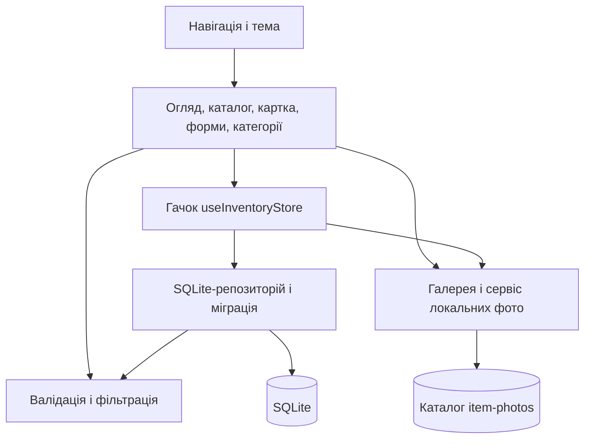
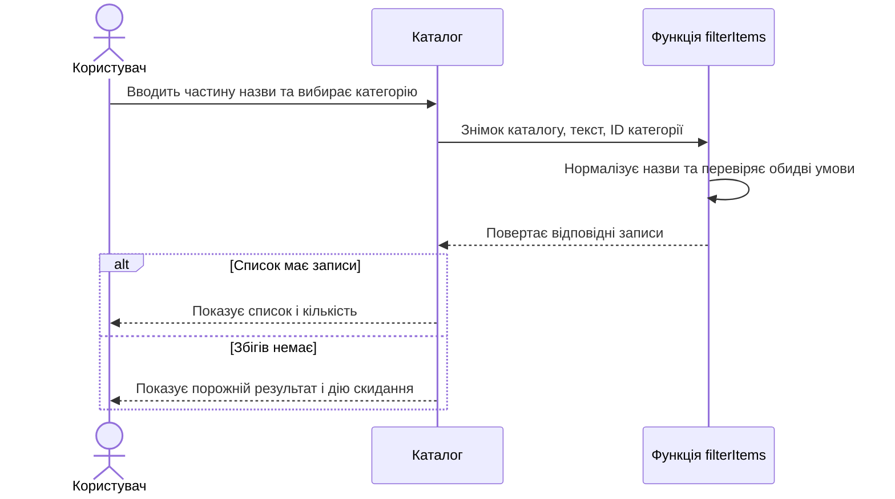

# Архітектура

Застосунок складається з трьох вкладок. Вкладка «Огляд» показує підсумки і відкриває останні записи, «Каталог» відповідає за пошук, «Категорії» — за класифікацію. Картка речі відкривається поверх вкладок, форми додавання та редагування — у модальних екранах системного стека React Navigation. Вкладки і екрани підлаштовуються під системну тему iOS.

Репозиторій відкриває одну БД на сеанс, застосовує міграцію та повертає знімок даних. Команди запису в інтерфейсі виконуються по черзі. Після запису повторне читання оновлює список, назви категорій та лічильники. Якщо оновлення після запису не вдалось, застосунок показує дію повторного завантаження.

Каталог читає знімок з пам’яті. Для пошуку функція `normalizeName` нормалізує Unicode, прибирає крайні пробіли, уніфікує апостроф і переводить літери в нижній регістр. Функція `filterItems` перевіряє входження підрядка в назву і рівність ідентифікатора категорії. Такий пошук окремого локального каталогу лінійний за кількістю речей.

## Сценарій пошуку

## Фото

Expo ImagePicker відкриває галерею iOS. Поки користувач редагує форму, вона показує попередній перегляд. Під час збереження Expo FileSystem копіює вибране зображення в `Paths.document/item-photos`. SQLite зберігає тільки ім’я копії. Якщо запис у БД не виконався, нову копію прибирають. Після успішної заміни або видалення прибирають попередню копію. Під час наступного відкриття каталогу сервіс прибирає файли проєкту, на які вже немає посилань у БД. Оригінали в галереї лишаються доступними користувачеві.
