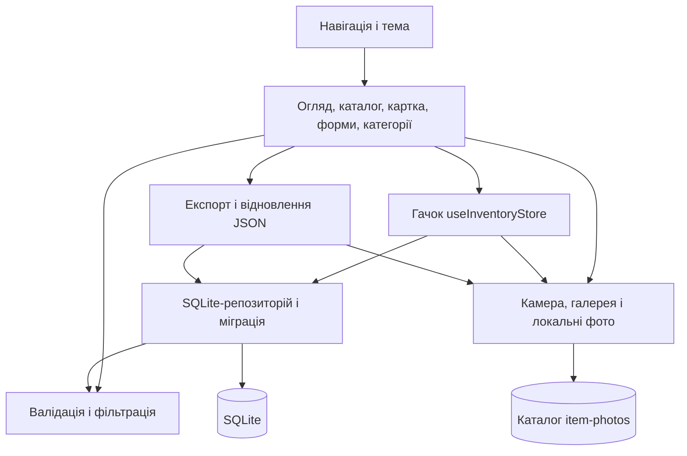
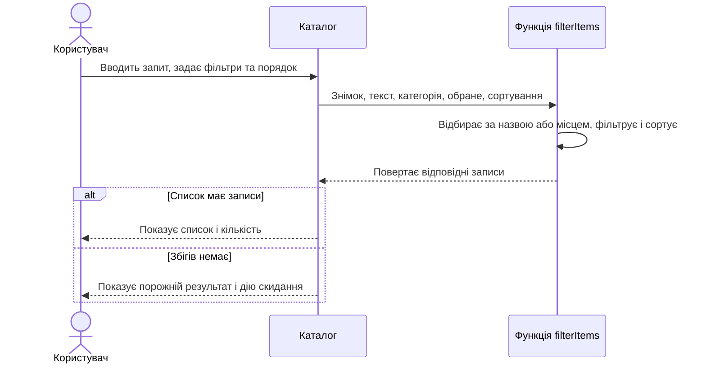

# Архітектура

Застосунок складається з чотирьох вкладок. «Огляд» показує підсумки й відкриває останні та обрані записи, «Каталог» відповідає за пошук, «Категорії» — за класифікацію, «Дані» — за експорт, відновлення і демо. Картка й перегляд фото відкриваються у стеку, форми — у модальних екранах React Navigation. Тема відповідає налаштуванням iOS.

Репозиторій відкриває одну БД на сеанс, застосовує міграцію та повертає знімок даних. Команди запису в інтерфейсі виконуються по черзі. Після запису повторне читання оновлює список, назви категорій та лічильники. Якщо оновлення після запису не вдалось, застосунок показує дію повторного завантаження.

Каталог читає знімок з пам’яті. `normalizeName` нормалізує Unicode, прибирає крайні пробіли, уніфікує апостроф і переводить літери в нижній регістр. `filterItems` перевіряє входження в назву або місце та застосовує категорію і стан обраного. Сортування за назвою і місцем використовує український колатор.

## Сценарій пошуку

## Фото

Expo ImagePicker відкриває галерею або камеру iOS. Перед запуском камери після натискання кнопки перевіряється дозвіл. У формі показується попередній перегляд. Під час збереження Expo FileSystem копіює зображення в `Paths.document/item-photos`. SQLite зберігає ім’я копії. Якщо запис у БД не виконався, нову копію прибирають. Після успішної заміни або видалення прибирають попередню копію. Під час наступного відкриття каталогу сервіс прибирає файли проєкту, на які вже немає посилань у БД.

## Резервна копія

JSON містить версію формату, категорії та поля речей, а також байти фото у Base64. Відновлення перевіряє ввід, показує підсумок і після згоди готує нові локальні фото. SQLite замінює таблиці в транзакції. Старі фото видаляються після успішної заміни даних. Системна дія поширення передає файл лише після вибору користувача.
