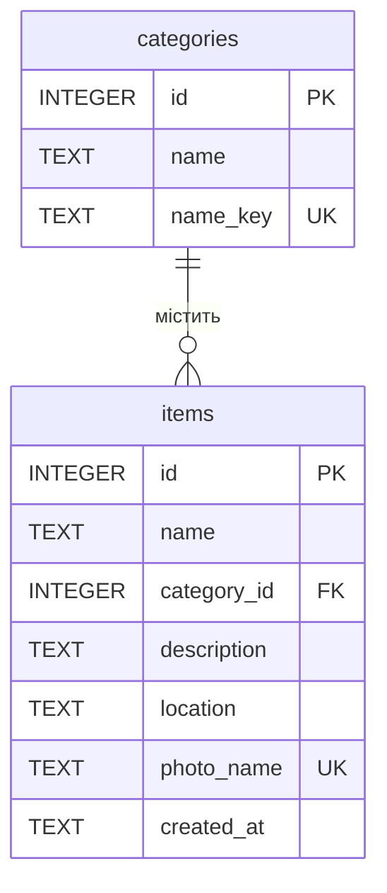

# База даних

Файл `osobysti-rechi.db` відкривається через Expo SQLite. Застосунок вмикає WAL і `PRAGMA foreign_keys = ON` перед міграцією. Версія зберігається в `PRAGMA user_version`.

| Поле | Правило |
| --- | --- |
| `categories.name` | Обов’язкове, до 50 символів. |
| `categories.name_key` | Унікальний нормалізований ключ. Відображається оригінальна назва. |
| `items.name` | Обов’язкове, до 100 символів. |
| `items.category_id` | Обов’язковий зовнішній ключ із `ON DELETE RESTRICT`. |
| `items.description`, `items.location` | Необов’язковий ввід, зберігається порожнім рядком за відсутності. Ліміт 1000 і 150 символів відповідно. |
| `items.photo_name` | Унікальне ім’я локального файлу або NULL. |
| `items.created_at` | Дата створення в ISO 8601 (UTC). Редагування її не змінює. |

Індекс `items_category_idx` підтримує роботу із зовнішнім ключем і підрахунок пов’язаних речей. Індекс `items_created_idx` упорядковує речі за датою та ідентифікатором від нових до старих. Унікальні ключі мають індекси SQLite. Ввід в операціях CRUD передається параметрами. Перед видаленням категорії запит перевіряє відсутність речей, а зовнішній ключ додатково гарантує цілісність БД.

Міграція `0 → 1` в одній транзакції створює таблиці та індекси, додає «Електроніка», «Документи», «Одяг» і «Дім» та встановлює версію 1. Повторне відкриття версії 1 зберігає зміни користувача. Невідома новіша версія спричиняє помилку відкриття.
