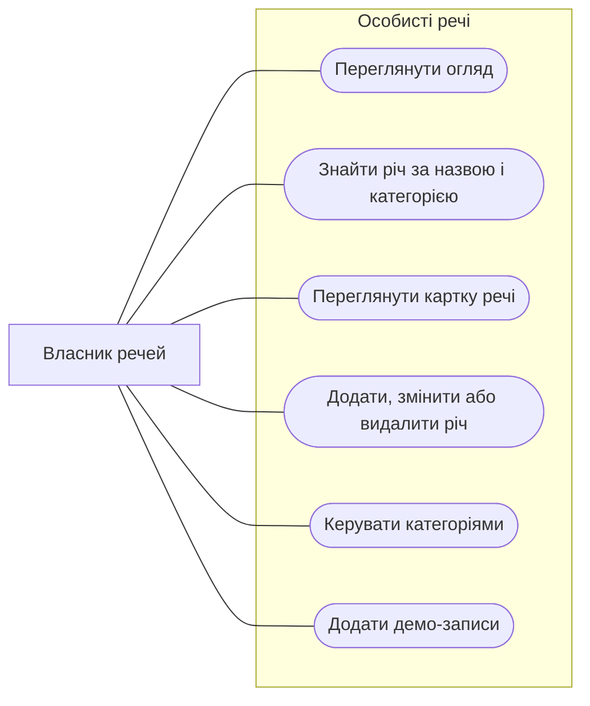

# Вимоги до застосунку

Тема курсової роботи ХНТУ 2026 року — «Розробка мобільного застосунку для обліку особистих речей та пошуку за категоріями».

Власник речей веде приватний каталог. Типове завдання — знайти предмет за частиною назви, звузити результати категорією та подивитися місце зберігання.

| Код | Критерій приймання |
| --- | --- |
| F01 | На «Огляді» показано кількість речей і категорій, до п’яти останніх записів та дію «Додати річ». |
| F02 | Річ можна додати, відкрити, змінити та видалити після підтвердження. Назва й категорія обов’язкові, дата запису фіксується автоматично. |
| F03 | У каталозі відображаються назва, категорія, місце і фото за наявності. Для порожнього каталогу і порожнього результату є окремі повідомлення. |
| F04 | Стартові категорії можна перейменувати та видалити, а також створити нові. Пов’язана з річчю категорія захищена від видалення. |
| F05 | Пошук за частиною української назви і фільтр за категорією застосовуються одночасно. Регістр і варіанти апострофа не впливають на збіг. |
| F06 | Фото з галереї можна зберегти, замінити або вилучити. Після перезапуску фото читається з постійної копії проєкту. |
| F07 | Демо-записи додаються після окремого підтвердження і мають явну позначку «Демо». |
| N01 | Каталог і фото доступні локально після завантаження застосунку. Дані переживають перезапуск за умови збереження сховища Expo Go. |
| N02 | Екрани українською мовою, зі світлою та темною темами, Safe Area, станами помилки, завантаження і порожнього результату. |
| N03 | Проєкт запускається з Windows на фізичному iPhone через Expo Go SDK 58. У прикладному коді режим TypeScript strict. |

## Варіанти використання

Методичні рекомендації ХНТУ 2022 року орієнтуються на вебзастосунки. Формат демонстрації мобільного застосунку й комплект графічних матеріалів слід погодити з керівником курсової. У документації використано затверджене формулювання мобільної теми.
